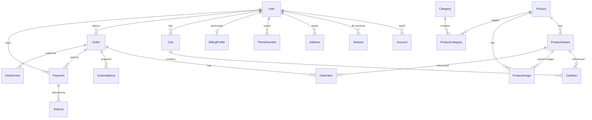

# Database architecture

Status: **implemented through phase 4** — 2026-11-09 (additive order/payment fields included)
Audience: every session/agent working on storefront, checkout, admin, payments or Printful.

> This file is the source of truth for the data model. If code and this document
> disagree, the code is wrong. Any schema change must update this file **and**
> ship with a migration (`bun run db:migrate --name …` → `bun run db:turso:deploy`).
> Do not hand-edit the Turso schema.

---

## 0. What other agents may assume

- Database: **SQLite locally, Turso (libSQL) in production**, via Prisma 7 + `@prisma/adapter-libsql`.
- Auth: **Auth.js (`@auth/core`) with database sessions** (opaque token in an httpOnly cookie). No JWT sessions.
- Email/password uses **custom endpoints that write the same `Session` row/cookie**, because Auth.js's `Credentials` provider only supports JWT sessions (see §6.1). Google OAuth goes through Auth.js normally.
- Roles live on `User.role`: `customer` (default), `staff`, `admin`.
- Money is stored as **integer minor units** (`Int`, cents). `Float` money is legacy and is removed in phase 5.
- IDs are `cuid()` strings. Timestamps are UTC.
- SQLite has no enums and no scalar lists: enum-like columns are `String` with documented values; arrays are JSON text (`colors`) or relation tables (`ProductImage`).
- Guest checkout is allowed. `Order.userId` is nullable; `Order.email` is always present.
- The cart is server-side (`Cart` / `CartItem`) for both guests and logged-in users.
- Every order stores **snapshots** of its addresses and items; editing a user's saved address later must not change history.
- The existing `ADMIN_TOKEN` check stays only as a machine-to-machine fallback for Printful/CLI calls. Browsers and humans use sessions + roles.
- Payments go through a **provider adapter** (`server/payments/*`, selected by `PAYMENT_PROVIDER`). Stripe is the default; see [`docs/payments.md`](payments.md). Nothing outside `server/payments/` may import a provider SDK.
- Transactional email is a separate `EmailProvider` adapter (Resend by default). Payment receipts come from the payment provider; order/shipping/auth emails come from our app.
- Never trust prices, totals, roles, or user ids sent by the client.

---

## 1. Decisions

| Area | Decision |
| --- | --- |
| Auth library | `@auth/core` (Auth.js v5) + `@auth/prisma-adapter` |
| Session strategy | `database` — table `Session`, 30-day sliding expiry (24h update age) |
| Password hashing | Argon2id (`@node-rs/argon2`), PHC string in `User.passwordHash` |
| Login methods | Email/password (custom endpoint writing `Session` rows) + **Google OAuth** (Auth.js). See §6.1 and `docs/payments.md` §6. |
| Roles | `customer`, `staff`, `admin` (string column, app-enforced) |
| Payments | Provider-agnostic adapter; **Stripe** is the default (`provider = "stripe"`). Polar was evaluated and rejected for physical goods (`docs/payments.md`). |
| Payment UX | Stripe PaymentIntent (`clientSecret`) or hosted redirect; the webhook is the only source of truth |
| Email | `EmailProvider` adapter; **Resend** free tier by default; `console` in dev. Provider sends receipts, we send order/shipping/auth mail. |
| Money | `Int` cents everywhere (`*Cents`), currency ISO-4217 per row |
| Cart | One active cart per user; guests get a random `Cart.token` cookie |
| Order status | `status` = fulfillment lifecycle, `paymentStatus` = money, `printfulStatus` = raw remote value |
| Product visibility | `Product.status` (`draft`, `active`, `archived`) replaces `isActive` on products only |
| Deletes | Soft delete via `isActive` / `status`; users are anonymised, not deleted |

---

## 2. Entity overview



---

## 3. Conventions

| Topic | Rule |
| --- | --- |
| Table/model names | PascalCase singular, no `@@map` (matches existing tables) |
| Primary keys | `id String @id @default(cuid())` |
| Timestamps | `createdAt DateTime @default(now())`, `updatedAt DateTime @updatedAt` |
| Money | `Int` minor units, suffix `Cents` (`priceCents`, `totalCents`) |
| Currency | ISO-4217 uppercase (`USD`); never mix currencies in a cart/order |
| Enums | `String` + documented values in this file; validate at the API boundary |
| Arrays | JSON text (`colors`, `metadata`, `raw`) or a join table when queried |
| Country/state | ISO 3166-1 alpha-2 (`US`), state codes uppercase (`CA`) |
| Phone | E.164 where possible (`+14155550123`); keep a display `label` |
| JSON columns | `String?` containing JSON; parse through the existing `parseJson` helper |
| Soft delete | `isActive Boolean` or `status`; never hard-delete rows referenced by orders |
| Secrets | never stored in the DB except one-way hashes (password, reset token) |

---

## 4. Schema

The blocks below are the canonical shape. Existing models are marked
`// exists`; everything else is new. `prisma/schema.prisma` is the compiled
result — keep both in sync.

### 4.1 Auth.js tables

Required by Auth.js and the Prisma adapter. Do not rename fields.

```prisma
model User {
  id            String    @id @default(cuid())
  name          String?
  email         String    @unique
  emailVerified DateTime?
  image         String?
  passwordHash  String?   // Argon2id PHC string; null for OAuth-only users
  role          String    @default("customer") // customer | staff | admin
  isActive      Boolean   @default(true)
  lastLoginAt   DateTime?
  createdAt     DateTime  @default(now())
  updatedAt     DateTime  @updatedAt

  accounts       Account[]
  sessions       Session[]
  addresses      Address[]
  phones         PhoneNumber[]
  billingProfile BillingProfile?
  carts          Cart[]
  orders         Order[]
  payments       Payment[]
  passwordResets PasswordResetToken[]
  auditLogs      AuditLog[]

  @@index([role])
}

model Account {
  id                String  @id @default(cuid())
  userId            String
  type              String
  provider          String
  providerAccountId String
  refresh_token     String?
  access_token      String?
  expires_at        Int?
  token_type        String?
  scope             String?
  id_token          String?
  session_state     String?
  user              User    @relation(fields: [userId], references: [id], onDelete: Cascade)

  @@unique([provider, providerAccountId])
  @@index([userId])
}

model Session {
  id           String   @id @default(cuid())
  sessionToken String   @unique
  userId       String
  expires      DateTime
  userAgent    String?  // nullable extras: adapter ignores them
  ipAddress    String?
  createdAt    DateTime @default(now())
  user          User     @relation(fields: [userId], references: [id], onDelete: Cascade)

  @@index([userId])
  @@index([expires])
}

model VerificationToken {
  identifier String
  token      String   @unique
  expires    DateTime

  @@unique([identifier, token])
}

model PasswordResetToken {
  id        String   @id @default(cuid())
  userId    String
  tokenHash String   @unique // SHA-256 of the token sent by email
  expires   DateTime
  usedAt    DateTime?
  createdAt DateTime @default(now())
  user      User     @relation(fields: [userId], references: [id], onDelete: Cascade)

  @@index([userId])
}
```

**Rules**

- `sessionToken` is an opaque random value generated by Auth.js. Never expose it.
- Deleting/banning a user (`isActive = false`) must delete all their `Session` rows.
- Changing a password or role must delete all `Session` rows for that user.
- Expired sessions are cleaned up opportunistically on login and by a daily job/endpoint.
- `Session.userAgent` / `ipAddress` are filled by the custom session helper, not the adapter.

### 4.2 Phones, addresses, billing

```prisma
model PhoneNumber {
  id         String    @id @default(cuid())
  userId     String
  e164       String
  label      String?   // mobile | home | work | other
  isPrimary  Boolean   @default(false)
  verifiedAt DateTime?
  createdAt  DateTime  @default(now())
  updatedAt  DateTime  @updatedAt
  user       User      @relation(fields: [userId], references: [id], onDelete: Cascade)

  @@unique([userId, e164])
  @@index([userId])
}

model Address {
  id                String   @id @default(cuid())
  userId            String
  label             String?  // "Home", "Office"
  kind              String   @default("both") // shipping | billing | both
  isDefaultShipping Boolean  @default(false)
  isDefaultBilling  Boolean  @default(false)
  name              String
  company           String?
  line1             String
  line2             String?
  city              String
  state             String?  // required for US/CA/AU (Printful rule)
  postalCode        String?
  countryCode       String   // ISO 3166-1 alpha-2
  phone             String?
  createdAt         DateTime @default(now())
  updatedAt         DateTime @updatedAt
  user              User     @relation(fields: [userId], references: [id], onDelete: Cascade)

  @@index([userId])
}

model BillingProfile {
  id           String   @id @default(cuid())
  userId       String   @unique
  companyName  String?
  vatId        String?  // EU VAT number
  taxId        String?  // US EIN / other national id
  taxExempt    Boolean  @default(false)
  invoiceEmail String?
  createdAt    DateTime @default(now())
  updatedAt    DateTime @updatedAt
  user         User     @relation(fields: [userId], references: [id], onDelete: Cascade)
}
```

**Rules**

- A user can have many addresses; at most one default shipping and one default billing (app-enforced).
- `kind` limits where an address may be used. Checkout rejects a billing address whose `kind = "shipping"`.
- `BillingProfile` is account-level tax data. The **snapshot** of the tax id used on an invoice is copied to `OrderAddress.taxId`.
- Deleting a user cascades their saved addresses/phones; existing orders keep their snapshots.

### 4.3 Cart

```prisma
model Cart {
  id        String     @id @default(cuid())
  userId    String?    // null = guest cart
  token     String?    @unique // random cookie value for guests
  status    String     @default("active") // active | converted | abandoned
  currency  String     @default("USD")
  expiresAt DateTime?
  createdAt DateTime   @default(now())
  updatedAt DateTime   @updatedAt
  user      User?      @relation(fields: [userId], references: [id], onDelete: Cascade)
  items     CartItem[]

  @@index([userId, status])
  @@index([token])
}

model CartItem {
  id             String         @id @default(cuid())
  cartId         String
  variantId      String
  quantity       Int            @default(1) // 1..99
  unitPriceCents Int            // price snapshot when added
  currency       String         @default("USD")
  createdAt      DateTime       @default(now())
  updatedAt      DateTime       @updatedAt
  cart           Cart           @relation(fields: [cartId], references: [id], onDelete: Cascade)
  variant        ProductVariant @relation(fields: [variantId], references: [id], onDelete: Cascade)

  @@unique([cartId, variantId])
  @@index([variantId])
}
```

**Rules**

- One active cart per user (app-enforced: `findFirst({ userId, status: "active" })`).
- Guest cart is identified by the `cart_token` httpOnly cookie (32 random bytes, 30 days).
- On login/registration: merge guest items into the user's active cart, sum quantities (cap 99), delete the guest cart, clear the cookie.
- `unitPriceCents` is only a display cache. `GET /api/cart` refreshes it from the variant, and checkout re-prices from the DB and rejects inactive/out-of-stock variants.
- A cart is `converted` when an order is created from it. Do not delete it immediately (support/debugging).
- Guest carts older than 30 days are deleted by the same cleanup job that removes expired sessions.

### 4.4 Catalog

`Product` and `ProductVariant` exist. Changes:

```prisma
model Product {
  id                  String   @id @default(cuid())
  slug                String   @unique
  printfulProductId   Int?     @unique
  externalId          String?  @unique
  name                String
  description         String   @default("")
  currency            String   @default("USD")
  status              String   @default("draft") // draft | active | archived
  priceCents          Int      @default(0)      // derived: min active variant price
  compareAtPriceCents Int?
  thumbnailUrl        String?
  raw                 String?  // raw Printful payload (JSON)
  createdAt           DateTime @default(now())
  updatedAt           DateTime @updatedAt

  images     ProductImage[]
  variants   ProductVariant[]
  categories ProductCategory[]
  orderItems OrderItem[]

  @@index([status])
}

model ProductVariant {
  id                  String   @id @default(cuid())
  productId           String
  printfulVariantId   Int?     @unique
  catalogVariantId    Int?
  externalId          String?  @unique
  name                String
  size                String?
  color               String?
  colors              String   @default("[]") // JSON array of hex swatches
  priceCents          Int?
  compareAtPriceCents Int?
  currency            String?
  image               String?
  sku                 String?
  inStock             Boolean  @default(true)
  isActive            Boolean  @default(true)
  createdAt           DateTime @default(now())
  updatedAt           DateTime @updatedAt

  product    Product        @relation(fields: [productId], references: [id], onDelete: Cascade)
  images     ProductImage[]
  cartItems  CartItem[]
  orderItems OrderItem[]

  @@index([productId])
  @@index([catalogVariantId])
  @@index([isActive, inStock])
}

model ProductImage {
  id        String          @id @default(cuid())
  productId String
  variantId String?
  url       String
  alt       String?
  position  Int             @default(0)
  createdAt DateTime        @default(now())
  product   Product         @relation(fields: [productId], references: [id], onDelete: Cascade)
  variant   ProductVariant? @relation(fields: [variantId], references: [id], onDelete: SetNull)

  @@index([productId, position])
}

model Category {
  id          String            @id @default(cuid())
  slug        String            @unique
  name        String
  description String?
  position    Int               @default(0)
  parentId    String?
  createdAt   DateTime          @default(now())
  updatedAt   DateTime          @updatedAt
  parent      Category?         @relation("CategoryTree", fields: [parentId], references: [id], onDelete: SetNull)
  children    Category[]        @relation("CategoryTree")
  products    ProductCategory[]

  @@index([parentId])
}

model ProductCategory {
  productId  String
  categoryId String
  product    Product  @relation(fields: [productId], references: [id], onDelete: Cascade)
  category   Category @relation(fields: [categoryId], references: [id], onDelete: Cascade)

  @@id([productId, categoryId])
  @@index([categoryId])
}
```

**Rules**

- Storefront queries must filter `Product.status = "active"` and `ProductVariant.isActive = true` (and `inStock` when buying).
- Product image order comes from `ProductImage.position`; `thumbnailUrl` is a cached convenience field.
- The Printful sync writes `ProductImage` rows (replace-all per product) and keeps `raw`.
- `priceCents` is always the minimum price of active variants. Serializers expose `price` in major units for the existing UI.
- Removing `Product.images` (JSON) happens in the same migration that backfills `ProductImage`.

### 4.5 Orders

```prisma
model Order {
  id                String    @id @default(cuid())
  orderNumber       String    @unique // DOT-…
  externalId        String    @unique // sent to Printful (max ~32 chars)
  userId            String?   // null = guest checkout
  status            String    @default("pending") // see vocabulary below
  paymentStatus     String    @default("unpaid")
  printfulStatus    String?   // raw status returned by Printful
  email             String
  customerName      String?
  currency          String    @default("USD")
  subtotalCents     Int
  discountCents     Int       @default(0)
  taxCents          Int       @default(0)
  shippingCents     Int       @default(0)
  totalCents        Int
  refundedCents     Int       @default(0)
  shippingMethod    String?
  shippingService   String?
  printfulOrderId   Int?      @unique
  trackingNumber    String?
  trackingUrl       String?
  carrier           String?
  shippedAt         DateTime?
  deliveredAt       DateTime?
  canceledAt        DateTime?
  failureReason     String?
  ipAddress         String?
  userAgent         String?
  raw               String?   // raw Printful payload (JSON)
  createdAt         DateTime  @default(now())
  updatedAt         DateTime  @updatedAt

  user      User?          @relation(fields: [userId], references: [id], onDelete: SetNull)
  items     OrderItem[]
  addresses OrderAddress[]
  payments  Payment[]
  events    OrderEvent[]

  @@index([userId])
  @@index([email])
  @@index([status])
  @@index([paymentStatus])
}

model OrderItem {
  id             String   @id @default(cuid())
  orderId        String
  productId      String?
  variantId      String?
  printfulItemId Int?
  printfulVariantId Int?
  name           String   // snapshot
  sku            String?
  size           String?
  color          String?
  quantity       Int
  unitPriceCents Int
  lineTotalCents Int
  currency       String   @default("USD")
  order          Order    @relation(fields: [orderId], references: [id], onDelete: Cascade)
  product        Product?        @relation(fields: [productId], references: [id], onDelete: SetNull)
  variant        ProductVariant? @relation(fields: [variantId], references: [id], onDelete: SetNull)

  @@index([orderId])
  @@index([productId])
}

model OrderAddress {
  id          String  @id @default(cuid())
  orderId     String
  kind        String  // shipping | billing
  name        String
  company     String?
  line1       String
  line2       String?
  city        String
  state       String?
  postalCode  String?
  countryCode String
  phone       String?
  email       String?
  taxId       String? // snapshot from BillingProfile for invoices
  order       Order   @relation(fields: [orderId], references: [id], onDelete: Cascade)

  @@unique([orderId, kind])
  @@index([orderId])
}

model OrderEvent {
  id        String   @id @default(cuid())
  orderId   String
  type      String
  message   String
  payload   String?  // JSON
  createdAt DateTime @default(now())
  order     Order    @relation(fields: [orderId], references: [id], onDelete: Cascade)

  @@index([orderId])
}
```

**Order status vocabulary** (`Order.status`)

| Value | Meaning |
| --- | --- |
| `pending` | Created, payment not captured |
| `submitted` | Printful draft created, not confirmed |
| `in_production` | Confirmed, Printful is producing |
| `partially_fulfilled` | Some items shipped |
| `fulfilled` | All items produced |
| `shipped` | At least one shipment in transit |
| `delivered` | A shipment was delivered |
| `returned` | Shipment returned |
| `on_hold` | Printful hold |
| `canceled` | Canceled locally or remotely |
| `refunded` | Fully refunded |
| `failed` | Printful failure |

Printful mapping: `draft` → `submitted`, `inprocess` → `in_production`,
`partial` → `partially_fulfilled`, `fulfilled` → `fulfilled`, everything else
maps to the same name (`onhold` → `on_hold`).

**Payment status vocabulary** (`Order.paymentStatus`)

`unpaid` | `processing` | `paid` | `partially_refunded` | `refunded` | `failed`

**Rules**

- `totalCents = subtotalCents - discountCents + taxCents + shippingCents` (never negative).
- Prices/names/sizes/colors are snapshotted into `OrderItem`; later product edits must not change past orders.
- Addresses are snapshotted into `OrderAddress` (both `shipping` and `billing` if supplied).
- Printful fulfilment (`/confirm`) is only allowed when `paymentStatus` is `paid` or `processing` with a captured payment.
- Guest orders set `userId = null` and are looked up by `orderNumber` + `email` (constant-time email comparison, 404 on mismatch).
- Users can read only their own orders (`Order.userId = session.user.id`); staff/admin may read all.

### 4.6 Payments

```prisma
model Payment {
  id                  String   @id @default(cuid())
  orderId             String
  userId              String?
  provider            String   @default("stripe") // stripe | polar | paypal | manual (see docs/payments.md)
  providerPaymentId   String?  @unique           // PaymentIntent id / Polar order id
  providerCheckoutId  String?  @unique           // Checkout Session id / Polar checkout id
  providerCustomerId  String?
  status              String   @default("requires_payment_method")
  amountCents         Int
  amountRefundedCents Int      @default(0)
  currency            String   @default("USD")
  method              String?  // card | wallet | paypal | manual
  brand               String?  // visa, mastercard, …
  last4               String?
  receiptUrl          String?
  failureCode         String?
  failureMessage      String?
  metadata            String?  // JSON
  raw                 String?  // JSON webhook/API payload
  createdAt           DateTime @default(now())
  updatedAt           DateTime @updatedAt

  order   Order    @relation(fields: [orderId], references: [id], onDelete: Cascade)
  user    User?    @relation(fields: [userId], references: [id], onDelete: SetNull)
  refunds Refund[]

  @@index([orderId])
  @@index([status])
  @@index([provider])
}

model Refund {
  id               String   @id @default(cuid())
  paymentId        String
  providerRefundId String?  @unique
  amountCents      Int
  currency         String   @default("USD")
  reason           String?
  status           String   @default("pending") // pending | succeeded | failed | canceled
  createdAt        DateTime @default(now())
  updatedAt        DateTime @updatedAt
  payment          Payment  @relation(fields: [paymentId], references: [id], onDelete: Cascade)

  @@index([paymentId])
}
```

**Payment status vocabulary** (normalized; each adapter maps its provider's statuses into these)

`requires_payment_method` | `requires_confirmation` | `requires_action` |
`processing` | `succeeded` | `canceled` | `failed`

**Rules**

- One order may have multiple payments (retries); at most one may be `succeeded` for the full amount unless the rest are refunded/failed.
- `amountCents`, `amountRefundedCents` and `Refund.amountCents` are authoritative; the order totals are updated from them in the same transaction.
- Provider SDKs live only in `server/payments/`. The rest of the app sees the normalized events from `docs/payments.md` §4.
- `providerCheckoutId` is for hosted checkout sessions; `providerPaymentId` is the id used for refunds and reconciliation.
- Payment mutations happen **only** through the provider webhook handler, the admin `mark-paid`/`refund` endpoints, or the initial payment creation response.
- Webhook handlers must be idempotent: dedupe on `(provider, event id)` via `WebhookEvent`.
- Never mark an order paid from the client redirect — only from a verified webhook (the redirect may be replayed/forged).
- Refunds require `admin`; staff can request/annotate but not execute.

**Checkout flow (provider-agnostic)**

1. `POST /api/checkout` (authenticated or guest with cart cookie) re-prices the cart, quotes shipping, creates `Order` (`pending`/`unpaid`) + `OrderItem`/`OrderAddress` snapshots.
2. Server calls `paymentProvider.createPayment(...)` and stores `Payment` (`requires_payment_method` / `pending`) with the returned ids. The cart is marked `converted` in the same transaction as that `Payment` row, so a provider failure leaves the cart active while a canceled hosted checkout leaves an unpaid order.
3. The response is `{ clientSecret }` (browser confirms with Stripe.js) or `{ redirectUrl }` (hosted checkout). Both are supported by the adapter interface.
4. The provider's verified webhook maps to `payment_succeeded` → `Payment.succeeded`, `Order.paymentStatus = paid`, `Order.status = submitted`, then submits the order to Printful as a draft.
5. Admin confirms fulfilment (`/confirm`) only after payment.
6. Refund events → `Refund` row, recompute `amountRefundedCents`, `Order.paymentStatus`, `Order.refundedCents`.

---

## 5. Supporting tables

```prisma
model WebhookEvent {
  id          String    @id @default(cuid())
  provider    String    @default("printful") // printful | stripe
  eventType   String
  eventKey    String?   // provider event id
  version     String?
  payload     String
  status      String    @default("received") // received | processed | ignored | failed
  error       String?
  createdAt   DateTime  @default(now())
  processedAt DateTime?

  @@unique([provider, eventKey])
  @@index([provider, eventType])
  @@index([status])
}

model AuditLog {
  id         String   @id @default(cuid())
  actorId    String?
  action     String   // user.role_changed, order.refunded, product.synced, …
  entityType String
  entityId   String?
  before     String?  // JSON
  after      String?  // JSON
  ipAddress  String?
  userAgent  String?
  createdAt  DateTime @default(now())
  actor      User?    @relation(fields: [actorId], references: [id], onDelete: SetNull)

  @@index([actorId])
  @@index([entityType, entityId])
  @@index([createdAt])
}

model AppSetting {
  key       String   @id
  value     String
  updatedAt DateTime @updatedAt
}
```

`WebhookEvent` replaces the Printful-only table. The existing rows gain
`provider = "printful"`; the unique key is `(provider, eventKey)` so Stripe event
ids cannot collide with Printful ids.

`AppSetting` keeps integration settings (Printful secrets, feature flags).

---

## 6. Auth.js wiring (Nuxt/Nitro)

### 6.1 Why email/password is custom

Auth.js's `Credentials` provider is **incompatible with database sessions**:
`@auth/core`'s credentials callback always encodes a JWT and never calls
`adapter.createSession`, and `assertConfig` rejects a credentials-only setup with
`session.strategy = "database"` (`UnsupportedStrategy: Signing in with
credentials only supported if JWT strategy is enabled`). Adding an OAuth provider
makes the config pass, but credentials login still writes a JWT into the session
cookie, which the database lookup cannot resolve.

So:

- **Auth.js owns** `/api/auth/session`, `/api/auth/csrf` and the Google OAuth
  callback — all backed by the `Session` table. `/api/auth/signout` also works;
  the storefront uses `POST /api/auth/logout` instead so it can also clear the
  guest cart cookie.
- **Email/password is a small custom flow** that writes a `Session` row and sets
  the exact cookie Auth.js expects. From Auth.js's point of view it is just
  another database session.

This keeps a single, revocable session model (the requirement) without a JWT.

### 6.4 Packages

```bash
bun add @auth/core @auth/prisma-adapter @node-rs/argon2
```

### 6.5 Files

| File | Responsibility |
| --- | --- |
| `server/auth/config.ts` | `AuthConfig`: adapter, OAuth providers, callbacks, pages |
| `server/auth/session.ts` | `createSession`, `destroySession`, cookie name/attributes (§6.2) |
| `server/api/auth/[...all].ts` | Auth.js catch-all: `Auth(toWebRequest(event), authConfig)` + `sendWebResponse` |
| `server/api/auth/login.post.ts`, `register.post.ts`, `logout.post.ts` | Custom email/password flow (§6.3) |
| `server/utils/auth.ts` | `getSessionUser`, `requireUser`, `requireRole`, `requireStaff`, `requireAdmin` |
| `app/composables/useAuth.ts` | Client session fetch, `login`, `logout`, `register` helpers |
| `app/middleware/auth.ts` | Client guard for `/account/**` (server is still authoritative) |
| `app/middleware/admin.ts` | Client guard for `/admin/**` |

### 6.6 Configuration

```ts
// server/auth/config.ts (shape, not final code)
import { PrismaAdapter } from "@auth/prisma-adapter";
import Google from "@auth/core/providers/google";
import { prisma } from "../utils/prisma";

export const authConfig = {
  adapter: PrismaAdapter(prisma),
  session: { strategy: "database", maxAge: 30 * 24 * 60 * 60, updateAge: 24 * 60 * 60 },
  pages: { signIn: "/login", error: "/login" },
  trustHost: true,
  secret: process.env.AUTH_SECRET,
  providers: [
    // No Credentials provider here — see §6.1.
    ...(process.env.AUTH_GOOGLE_ID && process.env.AUTH_GOOGLE_SECRET
      ? [Google({ allowDangerousEmailAccountLinking: false })]
      : []),
  ],
  callbacks: {
    async session({ session, user }) {
      session.user.id = user.id;
      session.user.role = user.role;
      session.user.isActive = user.isActive;
      return session;
    },
  },
};
```

- `allowDangerousEmailAccountLinking` stays **false**; otherwise an attacker
  could take over an email/password account with the same email.
- `callbacks.session` is the only place `role` is attached — never trust a
  client-supplied role.
- With Google credentials absent the `providers` array is empty; the session,
  sign-out and CSRF endpoints still work for email/password sessions.
- Google is enabled whenever both env vars are present (always in production).
  Redirect URI: `{AUTH_URL}/api/auth/callback/google`; scopes `openid email profile`.
- OAuth-only users have `User.passwordHash = null` and can set a password later
  from `/account/security`. Existing password users must sign in first and
  explicitly link Google — `allowDangerousEmailAccountLinking: false` means
  Auth.js refuses to auto-link by email (`OAuthAccountNotLinked`).
- The Google callback still creates a database `Session`; Auth.js never issues a
  JWT here.

### 6.2 Session cookie contract

Custom login/logout must reproduce Auth.js's cookie exactly, otherwise
`/api/auth/session` will not see the session.

| Property | Development | Production |
| --- | --- | --- |
| Name | `authjs.session-token` | `__Secure-authjs.session-token` |
| Value | opaque token (`randomBytes(32).toString("base64url")`) stored in `Session.sessionToken` | same |
| `httpOnly` | `true` | `true` |
| `sameSite` | `lax` | `lax` |
| `path` | `/` | `/` |
| `secure` | `false` | `true` |
| `expires` | `now + 30 days` | same |

Use the secure name whenever `AUTH_URL` starts with `https://`. Never reuse the
JWT chunking logic — the opaque token is short.

### 6.3 Custom credentials endpoints

| Endpoint | Behaviour |
| --- | --- |
| `POST /api/auth/register` | Validate email + password (min 12 chars), Argon2id hash, create `User` (`role = "customer"`), create session + cookie, merge guest cart |
| `POST /api/auth/login` | Rate limit, constant-time password check (dummy hash when the user is missing), `isActive` check, create session + cookie, update `lastLoginAt`, merge guest cart |
| `POST /api/auth/logout` | Delete the `Session` row for the cookie token, clear the cookie with the same attributes |
| `POST /api/auth/forgot-password` | Always `204`; if the user exists, store the SHA-256 of a 32-byte token in `PasswordResetToken` (1h) and email the raw token |
| `POST /api/auth/reset-password` | Look up the hash, check `expires`/`usedAt`, update `passwordHash`, mark `usedAt`, delete **all** sessions of that user |
| `POST /api/auth/logout-all` | Authenticated; delete every session of the user |

Session creation (shared by register/login):

```ts
const sessionToken = randomBytes(32).toString("base64url");
const expires = new Date(Date.now() + 30 * 24 * 60 * 60 * 1000);

await prisma.session.create({ data: { sessionToken, userId, expires } });
setCookie(event, sessionCookieName(), sessionToken, {
  httpOnly: true,
  sameSite: "lax",
  path: "/",
  secure: isHttps,
  expires,
});
```

### 6.7 Reading the session in server routes

```ts
// server/utils/auth.ts
export async function getSessionUser(event: H3Event) {
  const token =
    getCookie(event, "authjs.session-token") ??
    getCookie(event, "__Secure-authjs.session-token");
  if (!token) return null;

  const session = await prisma.session.findUnique({
    where: { sessionToken: token },
    include: { user: true },
  });

  if (!session || session.expires < new Date() || !session.user.isActive) {
    if (session) await prisma.session.delete({ where: { id: session.id } });
    return null;
  }

  return {
    id: session.user.id,
    email: session.user.email,
    name: session.user.name,
    role: session.user.role,
  };
}
```

- `requireUser(event)` → 401 when anonymous.
- `requireRole(event, roles)` → 401 when anonymous, 403 when wrong role.
- `requireStaff` = `["staff", "admin"]`, `requireAdmin` = `["admin"]`.
- `getSessionUser` only reads. Sliding expiry (`updateAge` 24h) is applied by
  Auth.js when the client calls `/api/auth/session`; long-lived server-only
  sessions that never hit that endpoint still expire after `maxAge`. Add the
  refresh to `getSessionUser` if server-only apps are added.
- The legacy token helper is renamed `requireAdminToken(event)` and is only
  used by `/api/printful/*` and automation. Admin endpoints accept **either** a
  valid admin session or the token (documented transition). New endpoints use
  roles only.

### 6.8 Cookies & security

| Control | Value |
| --- | --- |
| Session cookie | Auth.js defaults: `httpOnly`, `sameSite=lax`, `path=/`, `secure` on HTTPS |
| Cookie names | `authjs.session-token` (dev) / `__Secure-authjs.session-token` (prod) |
| Session lifetime | 30 days, sliding (`updateAge` 24h) |
| Password hash | Argon2id, OWASP baseline (19 MiB, t=2, p=1) |
| Password reset | 32-byte token, only SHA-256 stored, 1h expiry, single use |
| Login rate limit | 5 attempts / 15 min per IP+email; generic error message |
| CSRF | Auth.js built-in for its routes; custom cookie-authenticated POST/PATCH/DELETE also check `Origin`/`Sec-Fetch-Site` |
| Session invalidation | password change, role change, `isActive=false`, manual "logout everywhere" |
| Audit | admin mutations write `AuditLog` (actor, before, after, ip, ua) |
| PII | never log emails/phones/addresses; anonymise on GDPR delete (`email = deleted+<id>@invalid`, clear names/phones/addresses) |

### 6.9 Authorization matrix

| Surface | Guest | Customer | Staff | Admin |
| --- | --- | --- | --- | --- |
| Catalog, cart (own), checkout, tracking | ✅ | ✅ | ✅ | ✅ |
| Own account, addresses, orders, payments | ❌ | ✅ | ✅ | ✅ |
| Order list / detail (all) | ❌ | ❌ | ✅ | ✅ |
| Refunds | ❌ | ❌ | ❌ | ✅ |
| Product sync / webhooks / settings | ❌ | ❌ | ❌ | ✅ (or admin token) |
| Role changes, user deactivation | ❌ | ❌ | ❌ | ✅ |

---

## 7. API surface affected

| Endpoint | Change |
| --- | --- |
| `ALL /api/auth/*` | New — Auth.js handler (`session`, `signout`, `csrf`, OAuth callbacks) |
| `GET /api/auth/session` | New — Auth.js response `{ user: { id, email, name, role, image }, expires }` or `{}` (DB session) |
| `POST /api/auth/register` | New — create customer + Argon2id hash, then create session |
| `POST /api/auth/login`, `/logout`, `/logout-all` | New — custom credentials flow (§6.3) |
| `POST /api/auth/forgot-password`, `/reset-password` | New — `PasswordResetToken` flow |
| `GET /api/auth/callback/google` | New — Google OAuth (Auth.js); register `{AUTH_URL}/api/auth/callback/google` |
| `POST /api/account/security/link-google` | New — link Google to a signed-in password account (no auto-link by email) |
| `GET/PATCH /api/account` | New — profile |
| `GET/POST /api/account/addresses`, `PATCH/DELETE /api/account/addresses/{id}` | New |
| `GET/POST /api/account/phones`, `DELETE /api/account/phones/{id}` | New |
| `GET/PATCH /api/account/billing` | New — `BillingProfile` |
| `GET /api/cart`, `POST /api/cart/items`, `PATCH/DELETE /api/cart/items/{id}` | New — server cart, guest token cookie |
| `POST /api/checkout` | New — cart → order + provider session; returns `{ clientSecret }` or `{ redirectUrl }` |
| `POST /api/payments/webhook/[provider]` | New — signature-verified, idempotent via `WebhookEvent(provider, eventKey)`; adapters in `server/payments/` |
| `POST /api/orders` | Kept during transition; attaches `userId` when logged in, snapshots `OrderAddress`, uses cents |
| `GET /api/orders`, `GET /api/orders/{id}` | Customer sees own orders; staff/admin see all |
| `POST /api/orders/{id}/confirm` | Requires `admin`/`staff` **and** `paymentStatus IN (paid, processing)` |
| `POST /api/orders/{id}/refund` | New — admin only |
| `/api/printful/*` | Keep admin token; also allow admin session |
| `/api/webhooks/printful` | Writes `WebhookEvent.provider = "printful"` |

The existing `/api/orders` body keeps working for guests, but new clients should
use the cart + checkout endpoints so the server can persist the cart and
recompute totals.

---

## 8. Migration plan

The migration engine only understands local files, so each step is:

```bash
bun run db:migrate --name <step>   # local SQLite, generates prisma/migrations/*
bun run db:turso:deploy            # apply the same migrations to Turso
bun run db:generate                # regenerate the client (postinstall does this)
```

Phases (each is a separate migration unless noted):

| Phase | Contents | Breaking? |
| --- | --- | --- |
| 1 | `User`, `Account`, `Session`, `VerificationToken`, `PasswordResetToken`; `User.role` seed | no |
| 2 | `PhoneNumber`, `Address`, `BillingProfile` | no |
| 3 | `Cart`, `CartItem` | no |
| 4 | `Payment` (incl. `providerCheckoutId`), `Refund`, `WebhookEvent.provider`, `AuditLog`; additive `Order.userId`, `Order.paymentStatus`, `Order.refundedCents` so checkout/webhooks can ship before the money rewrite | no (all additions have defaults/nulls) |
| 5 | Money → `*Cents` on Product/Variant/Order/OrderItem; `ProductImage`; `Product.status`; `OrderAddress`; `Order.printfulStatus` | **yes** — code + data |
| 6 | Role enforcement, admin UI, legacy `ADMIN_TOKEN` reduced to machine calls | code only |

Phase 5 details:

- Multiply existing `price`, `subtotal`, `discount`, `tax`, `shippingCost`,
  `total`, `OrderItem.price` by 100 and round.
- Backfill `ProductImage` from `Product.images` JSON, then drop the column.
- Drop the legacy `Product.sizes` JSON column (sizes live on `ProductVariant.size`).
- Add `Product.slug` with a slugified `name` backfill (dedupe with `-2`, `-3`), then make it required and `@unique`.
- `Order.email` becomes required; backfill existing rows with a placeholder and treat them as guest orders.
- Backfill `OrderAddress` from `Order.recipient` JSON (`kind = "shipping"`),
  keep `recipient` until the Printful code is switched over.
- Map `isActive` → `status` (`true → active`, `false → archived`).
- New catalog columns (`compareAtPriceCents`, `ProductImage`, `Category`) start empty; the Printful sync repopulates them.
- Update `server/utils/products.ts`, `orders.ts`, `checkout.ts`, `shipping.ts`,
  `app/types.ts` and `app/utils/formatPrice.ts` in the same change.
- Production currently has only synced products and no orders, so a reset is
  acceptable if the backfill proves messy — confirm before doing it.

After each phase: `bun run typecheck` and a dev smoke test (`/api/products`,
`/api/auth/session`, cart endpoints).

---

## 9. Seed and environment

`prisma/seed.ts` must:

- Create/update the admin from `ADMIN_EMAIL` + `ADMIN_PASSWORD` (role `admin`,
  Argon2id hash). Skip silently when unset; never log the password.
- Optionally create a `customer@example.com` demo user outside production.
- Keep the existing product fixtures.

New environment variables (document in `.env.example`, never commit real values):

```dotenv
# Auth
AUTH_SECRET=""            # openssl rand -base64 32
AUTH_URL="http://localhost:3000"
AUTH_TRUST_HOST="true"
AUTH_GOOGLE_ID=""         # optional locally; required in production
AUTH_GOOGLE_SECRET=""

# Payments (see docs/payments.md)
PAYMENT_PROVIDER="stripe" # stripe | manual
STRIPE_SECRET_KEY=""
STRIPE_WEBHOOK_SECRET=""
# Future providers, unused while PAYMENT_PROVIDER=stripe:
POLAR_ACCESS_TOKEN=""
POLAR_WEBHOOK_SECRET=""
POLAR_ORGANIZATION_ID=""

# Email (see docs/payments.md §5)
EMAIL_PROVIDER="console"  # console | resend | smtp (resend in production)
RESEND_API_KEY=""
EMAIL_FROM="orders@example.com"
EMAIL_REPLY_TO="support@example.com"
SMTP_URL=""               # only for EMAIL_PROVIDER=smtp

# Seed
ADMIN_EMAIL=""
ADMIN_PASSWORD=""         # seed only
```

Production (Turso + host env) uses the same names; Nitro does not read `.env*`
at runtime.

---

## 10. Rules for future changes

1. Update this document in the same change as the schema.
2. Never add a table without a migration and a note about its lifecycle/retention.
3. Never store money as `Float`; use `*Cents`.
4. Never store a role/total/price supplied by the client.
5. Never confirm fulfilment before a captured payment.
6. Never make payment state changes outside the webhook path.
7. Keep auth tables field-compatible with `@auth/prisma-adapter`; additive
   nullable columns are fine, renames are not.
8. All admin mutations go through `AuditLog`.
9. Do not edit `prisma/dev.db` or the Turso schema by hand — always migrations.
10. When in doubt, prefer the narrower role and the stricter validation.

---

## 11. Decisions confirmed (2026-10-28)

- **Payments: Stripe.** Polar was evaluated and rejected because it excludes
  physical goods and does not support multi-product checkout; see
  [`docs/payments.md`](payments.md). The schema stays provider-agnostic, so
  PayPal/Polar can be added later without a migration.
- **Google OAuth: included.** Enabled when `AUTH_GOOGLE_ID`/`AUTH_GOOGLE_SECRET`
  are set; no automatic account linking by email (`docs/payments.md` §6).
- **Multi-currency: USD-only for now.** The schema is per-row currency-ready; the
  storefront, Printful catalogue and Stripe account all use USD.
- **Email: Resend free tier** behind an `EmailProvider` adapter; `console` in
  development. Password reset/verification links are logged only when
  `EMAIL_PROVIDER=console`.
- **Tax:** `taxCents` is provider/merchant supplied for now. Revisit Stripe Tax
  (or a physical-goods MoR) if international VAT/GST registration becomes
  material; that would add a `TaxBreakdown` table.
- **Printful confirmation** still requires a captured/paid payment and remains
  admin/staff-only.
